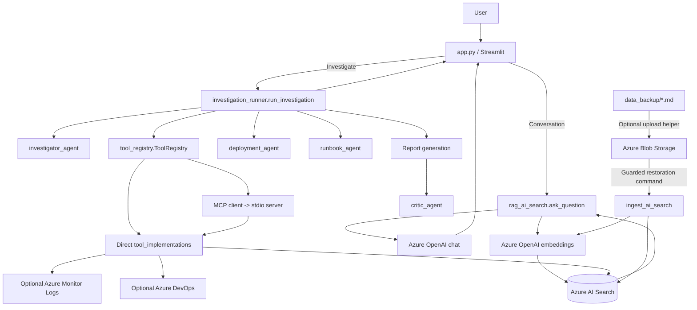

# EvalAgent Architecture, Operations, and Restoration Guide

This guide documents the current repository implementation. It is not an Azure deployment template, and it does not imply that Azure resources have been provisioned or that a live service is currently available. All Azure resource names, regions, deployment names, endpoints, and credentials must be supplied by the operator.

## 1. System overview

EvalAgent has two user-facing workflows:

1. **Conversation** is a retrieval-augmented question-answering path.
2. **Investigate** is a code-orchestrated multi-agent investigation that gathers evidence, produces a report, and requests a critic assessment.

Both use Azure OpenAI and Azure AI Search, but they have different orchestration and prompting. The tool layer can call shared implementations directly or through a local MCP stdio subprocess. Azure DevOps and Application Insights are optional enrichment sources.



### Current boundaries

- The planner proposes structured intent; application code decides which evidence sources to call. MCP is a provider boundary, not autonomous tool selection.
- Search results are grounding inputs, not guarantees of correctness. The report writer and critic are both models and neither is an independent verifier.
- Search and OpenAI use API-key credentials in the current runtime. Blob Storage and Application Insights use `DefaultAzureCredential`.
- Application histories are held in Streamlit session state. They are not database-backed or durable.
- No Container Apps manifest, Bicep/Terraform template, deployment workflow, or authentication configuration is included.

## 2. Repository map

| Path | Responsibility |
|---|---|
| [`app.py`](app.py) | Streamlit entry point, session state, workspace switching, request dispatch, and result rendering. |
| [`frontend.py`](frontend.py) | Report parsing/presentation, evidence display, local source-document lookup, and investigation metrics UI. |
| [`assets/dashboard.css`](assets/dashboard.css) | Dashboard styling, responsive metric layout, and narrow-screen tab overflow behavior. |
| [`backend/rag_ai_search.py`](backend/rag_ai_search.py) | Conversation embedding, vector retrieval, prompt assembly, and answer generation. |
| [`backend/search_ai_search.py`](backend/search_ai_search.py) | Vector retrieval and exact-document chunk retrieval. |
| [`backend/investigation_runner.py`](backend/investigation_runner.py) | Investigation planning flow, evidence selection, optional integrations, report generation, and critic review. |
| [`backend/investigator_agent.py`](backend/investigator_agent.py) | JSON-mode investigation planner. |
| [`backend/deployment_agent.py`](backend/deployment_agent.py) | Evidence-bound deployment analysis. |
| [`backend/runbook_agent.py`](backend/runbook_agent.py) | Evidence-bound runbook analysis and local purpose fallback. |
| [`backend/critic_agent.py`](backend/critic_agent.py) | Model-generated report review against supplied evidence. |
| [`backend/tool_registry.py`](backend/tool_registry.py) | Provider selection, execution timing, and tool facade. |
| [`backend/tool_implementations.py`](backend/tool_implementations.py) | Shared Search, Azure DevOps, and Application Insights tool implementations. |
| [`backend/evalagent_mcp_client.py`](backend/evalagent_mcp_client.py), [`backend/evalagent_mcp_server.py`](backend/evalagent_mcp_server.py) | Local MCP client/server transport and tool definitions. |
| [`backend/observability.py`](backend/observability.py) | Allowlisted JSON logging, operation correlation, token/request aggregation, and execution metrics. |
| [`backend/blob_storage_client.py`](backend/blob_storage_client.py) | Markdown download from Blob Storage and file upload helper. |
| [`backend/ingest_ai_search.py`](backend/ingest_ai_search.py) | Existing Blob-to-Search chunking, embedding, index schema, and upload pipeline. |
| [`backend/restore_search_index.py`](backend/restore_search_index.py) | Guarded create-only restoration entry point. |
| [`scripts/upload_data_to_blob.py`](scripts/upload_data_to_blob.py) | Uploads a local Markdown tree to Blob Storage. |
| [`data_backup/`](data_backup/) | Tracked Markdown source backup; not an exact serialized copy of the historical Search index. |
| [`tests/`](tests/) | Offline `unittest` regression tests and fixed evaluation cases. |
| [`Dockerfile`](Dockerfile), [`.dockerignore`](.dockerignore) | Digest-pinned, non-root Linux image and allowlisted build context. |

The older FAISS path (`backend/ingest.py`, `backend/rag.py`, and `backend/search.py`) is not used by the active app. Do not treat it as the current retrieval/indexing workflow.

## 3. Runtime request flows

### 3.1 Conversation workflow

`app.py` calls `backend.rag_ai_search.ask_question(question)`.

1. The question is embedded using `AZURE_OPENAI_EMBEDDING_DEPLOYMENT`.
2. Azure AI Search receives a vector query against the `embedding` field with `k_nearest_neighbors=5` and returns up to five records.
3. The records’ `file`, `chunk_id`, and `content` fields are formatted as context.
4. Azure OpenAI generates an answer using `AZURE_OPENAI_CHAT_DEPLOYMENT`, with a maximum completion budget of 3,000 tokens.
5. The function returns `(answer_text, sources)`. Each source has `file`, `chunk_id`, and `content`.

Prior chat turns are displayed by Streamlit but are not assembled into the backend prompt. A conversation is therefore document-grounded Q&A, not a persistent-context chat completion.

### 3.2 Investigation workflow

`app.py` calls `backend.investigation_runner.run_investigation(question, include_azure_devops=..., include_application_insights=...)`.

1. The planner requests a JSON object with investigation type, incident/deployment/runbook references, search flags, and optional Application Insights service/time range.
2. The runner retrieves an explicit incident by document name when identified; otherwise it can run vector search for incident evidence.
3. It extracts linked deployment, incident, and runbook references, then retrieves matching document chunks.
4. It chooses primary evidence, deduplicates selected evidence, and limits supporting evidence.
5. Deployment and runbook agents analyze only their selected evidence. JSON mode is requested, then response shapes and enumerated risk labels are validated by their respective modules.
6. If enabled and the planner or evidence provides a service and time range, the Application Insights tool queries Azure Monitor Logs. Explicit bounds are honored; a positive `APPLICATIONINSIGHTS_LOOKBACK_DAYS` default is used only when the UI explicitly selects Include and neither explicit bound is present. If only one explicit bound is provided, the runner does not substitute a default range.
7. If Azure DevOps is enabled and deployment evidence contains recognized work-item, pull-request, or repository markers, the runner requests matching records.
8. The report generator requests JSON-mode content and formats the result as Markdown.
9. The critic reviews the report against selected factual evidence and normalized Azure DevOps records.
10. The function returns `(report_text, evidence)`; Streamlit obtains the associated metrics separately.

The report contains Primary Evidence, Deployment Analysis, Runbook Analysis, Incident, Root Cause, Impact, Resolution, Related Documents, Recommendations, Azure DevOps Evidence, and Report Review sections. Missing facts should be identified as not established. The UI preserves unknown report sections and keeps the original Markdown available for inspection/download.

The critic is a second model call with a grounding-focused prompt. It does not provide independent validation, and its confidence/quality labels are not calibrated numerical probabilities.

### 3.3 Integrations and defaults

- **Azure DevOps:** Excluded by default in the UI. When enabled, the runner looks for recognized references in deployment evidence. The client calls Azure DevOps REST API 7.1 using a PAT and a 15-second request timeout. The `get_release` tool exists, but the current investigation runner does not automatically request release records.
- **Application Insights:** The UI offers Auto, Include, and Exclude. Auto leaves the decision to the plan; Include forces the boolean request; Exclude disables it. The backend queries workspace-based Azure Monitor Logs through `DefaultAzureCredential`, normalizes requests, dependencies, traces, and exceptions, and caps returned rows at 200 by default.
- **MCP:** `EVALAGENT_TOOL_PROVIDER=direct` is the default. `mcp` starts a local Python stdio MCP server for each tool invocation. The MCP server exposes seven tools and calls the same lower-level implementations as direct mode. It is not a remote MCP service.

## 4. Search and evidence contracts

### 4.1 Index and ingestion behavior

The established pipeline in [`backend/ingest_ai_search.py`](backend/ingest_ai_search.py):

- Downloads every Blob whose name ends in `.md`, decodes it as UTF-8, and replaces literal `\\n` sequences with line breaks.
- Splits text into 500-character chunks with a 100-character overlap (400-character start stride).
- Assigns zero-based numeric `chunk_id` values per document.
- Requests one embedding for each chunk using `AZURE_OPENAI_EMBEDDING_DEPLOYMENT`.
- Builds an index with `id` (key), `file` (searchable/filterable), `chunk_id` (filterable Int32), `content` (searchable), and `embedding` (single-precision vector).
- Uses an HNSW vector algorithm/profile; vector dimensions are taken from the first generated embedding.
- Uploads in batches of up to 1,000 documents.

Document IDs are formed from the file stem and chunk number. Keep source basenames unique; the tracked backup has been checked for basename uniqueness.

### 4.2 Retrieval behavior

- `search_chunks(query)` embeds the query and returns up to five nearest vector matches with `{file, chunk_id, content}`.
- `search_document(file_name)` applies a server-side `search.ismatch` filter against the existing `file` field, escaping Lucene phrase characters and OData apostrophes. It then retains exact case-insensitive basename matches and orders results by numeric `chunk_id`. It returns all matching chunks in the same three-field shape; Azure Search SDK pagination is consumed before ordering.
- `tool_implementations.py` adds source/category/primary metadata for the investigation workflow. The runner uses that metadata to identify primary evidence and render evidence.
- The Conversation RAG path performs vector retrieval only; do not describe it as hybrid text/vector search.
- There is no configured vector score threshold in the active retrieval functions. A top-five result is not necessarily a sufficient evidence set; the report should distinguish missing information.

The exact-document filter optimization was verified against the live index in an earlier audit. It reduces server-returned candidates, but no general latency improvement is claimed; measured latency can vary.

### 4.3 Return formats

Search functions return:

```python
{"file": "incidents/incident-1042.md", "chunk_id": 0, "content": "..."}
```

Tool-decorated evidence may also include:

```python
{
    "source": "azure_ai_search",
    "category": "incident",
    "primary": False,
    "file": "incidents/incident-1042.md",
    "chunk_id": 0,
    "content": "..."
}
```

The UI shows retrieved text in either mode. A full local document is shown only when the file basename can be located under `data/` or `data_backup/`; the app does not fetch the full document from Blob Storage during rendering.

## 5. Restoring Azure AI Search

### 5.1 What restoration does and does not restore

The repository has a tracked local source backup at [`data_backup/`](data_backup/). The guarded restoration command reuses the established Blob-to-Search ingestion code; it does not duplicate that pipeline or provision Azure resources.

Restoration reconstructs an index from the current Markdown documents and current chunking/embedding implementation. It is **not** a byte-for-byte or exact historical index restore. In a previous comparison, the live index had 101 chunks across 30 filenames with 1,536-dimensional embeddings, while the 30-file Git backup generated 99 chunks and differed in content. The live Blob documents matched the indexed content during that audit. These are historical observations, not guaranteed counts or current cloud state. Keep any source/document changes under version control and verify source files before rebuilding.

The normal restore command reads the configured Blob container. It does not ingest local files directly. The upload helper can seed Blob from the tracked backup.

### 5.2 Provisioning prerequisites

Provision resources through your organization’s approved process; no provisioning template is included. For a new environment, the operator sequence is:

1. Create or select an Azure OpenAI resource. Deploy a chat model for Conversation, a chat model that supports the investigation agents' JSON-mode requests, and an embedding model. The two chat settings may point to the same deployment if it supports both workflows.
2. Create an Azure AI Search service. Record its endpoint, choose an index name that does not already exist, and obtain an admin-capable key for the one-time schema creation/upload operation.
3. Create a Storage account and a private Blob container. The default container name is `evalagent-documents`; `AZURE_STORAGE_CONTAINER_NAME` can select another container. Configure the local restore identity to read it through `DefaultAzureCredential`; grant upload permission too if you are seeding it from local files.
4. If Application Insights enrichment is wanted, identify its workspace-based Log Analytics workspace and grant the local/workload identity permission to query logs. This is not required for Search restoration or ordinary Conversation retrieval.
5. If Azure DevOps enrichment is wanted, prepare an organization/project and least-privileged PAT. It is an optional external integration, not part of Azure resource restoration.

Select regions, Search capacity, and model deployments according to availability, quota, latency, and cost; the repository does not pick or provision SKUs. Restore requires Azure OpenAI embedding access and incurs usage charges. Azure AI Search incurs service capacity charges while provisioned.

### 5.3 Optional: upload the tracked backup to Blob

Create the target container first. From the repository root, configure the storage account and container in `.env`, authenticate with an identity authorized to upload, and run:

```powershell
python -c "from scripts.upload_data_to_blob import sync_local_data_to_blob; sync_local_data_to_blob('data_backup')"
```

The script uploads `*.md` files recursively while preserving their relative paths as blob names. It overwrites blobs with matching names but does **not** remove other blobs. Because ingestion reads every `.md` blob in the selected container, use a fresh/clean target container or inspect its contents to avoid including stale source documents.

The backup verification test checks that Markdown files are present, non-empty UTF-8, and have unique basenames. The prior repository audit confirmed that 30 Markdown source files are tracked. Git source backup protects the source documents, but it does not preserve embeddings or guarantee the same chunks as a historical Azure index.

### 5.4 Configure and run the guarded restore

Configure these values in the repository-root `.env`:

- `AZURE_SEARCH_ENDPOINT`
- `AZURE_SEARCH_KEY`
- `AZURE_SEARCH_INDEX` (set explicitly; do not rely on the ingestion-only default)
- `AZURE_OPENAI_ENDPOINT`
- `AZURE_OPENAI_API_KEY`
- `AZURE_OPENAI_EMBEDDING_DEPLOYMENT`
- `AZURE_STORAGE_ACCOUNT_NAME`
- `AZURE_STORAGE_CONTAINER_NAME` if not using the default

Then run:

```powershell
python -m backend.restore_search_index
```

The wrapper checks that the configured index is absent and refuses to replace it. It then invokes ingestion with create-only index behavior. If another actor creates the index between the preflight check and creation, `create_index` fails rather than updating/deleting it.

**Do not use `python backend/ingest_ai_search.py` for routine restoration.** Its direct entry point retains delete-and-recreate behavior when the configured index already exists. The guarded wrapper is the safe entry point.

The create-only check prevents intentional replacement; it does not make the entire restore transactional. Embeddings are generated before index creation/upload. A failure during creation or upload can leave paid embedding usage and a partially populated index. Inspect the target before retrying; the guarded command will refuse an index that now exists. Remove a partial index only after confirming the target and explicitly authorizing that destructive action.

### 5.5 Post-restore verification

The ingester checks the SDK upload result for failed chunks and prints the uploaded chunk count. It does not perform a full index read-back, compare every source chunk, or test vector retrieval.

After restoration:

1. Confirm the Azure AI Search index exists and has the fields/vector dimensions described in [Index and ingestion behavior](#41-index-and-ingestion-behavior).
2. Confirm expected document filenames/chunk counts using Azure AI Search tools or a controlled read-only script.
3. Test exact document retrieval for a known source and confirm ordered chunk IDs.
4. Test vector retrieval with a representative question, then run a small conversation request and an incident investigation.
5. Keep request/content data out of verification logs and reports.

Exact-document retrieval does not make an embedding request. Vector retrieval does make an Azure OpenAI embedding request; a complete Conversation or investigation smoke test also makes chat requests and may incur charges.

## 6. Configuration reference

`.env.example` is a template, not a secret store. The app loads `.env` in local runs through `python-dotenv`. The Docker image sets `PYTHON_DOTENV_DISABLED=1`; inject variables into the container environment instead. Never commit `.env` or put credentials in Docker build arguments.

| Variable | Required when | Purpose / behavior |
|---|---|---|
| `AZURE_OPENAI_ENDPOINT` | Any Azure OpenAI workflow | Azure OpenAI resource endpoint. |
| `AZURE_OPENAI_API_KEY` | Any Azure OpenAI workflow | API-key credential used by current OpenAI clients. |
| `AZURE_OPENAI_CHAT_DEPLOYMENT` | Conversation workflow | Chat deployment for `rag_ai_search.ask_question`. Must match a deployment available to the resource. |
| `AZURE_OPENAI_EMBEDDING_DEPLOYMENT` | Retrieval or restore | Embedding deployment for query embeddings and per-chunk restore embeddings. |
| `AZURE_OPENAI_GPT5_MINI_DEPLOYMENT` | Optional | Planner, deployment/runbook agents, report generation, and critic deployment. Defaults in code to `gpt-5-mini`; set it to an available compatible deployment if needed. |
| `AZURE_SEARCH_ENDPOINT` | Search/restore | Azure AI Search endpoint. |
| `AZURE_SEARCH_KEY` | Search/restore | API key passed through `AzureKeyCredential`. Restore requires index-management and upload permissions; serving queries only need query permission. The current code uses one variable for both roles. |
| `AZURE_SEARCH_INDEX` | Active Search retrieval and guarded restore | Index name. The active search functions require it. The ingester alone has a fallback name, so set it explicitly. |
| `AZURE_STORAGE_ACCOUNT_NAME` | Blob download/upload | Storage account name; Blob access uses `DefaultAzureCredential`, not a storage key in `.env`. |
| `AZURE_STORAGE_CONTAINER_NAME` | Optional Blob setting | Container name; defaults to `evalagent-documents`. |
| `AZDO_ORG` | Azure DevOps integration | Azure DevOps organization. |
| `AZDO_PROJECT` | Azure DevOps integration | Azure DevOps project. |
| `AZDO_PAT` | Azure DevOps integration | PAT used for REST calls. Use a least-privileged token, keep it secret, and omit it when the integration is disabled. |
| `APPLICATIONINSIGHTS_WORKSPACE_ID` | Application Insights query | Log Analytics workspace ID used by workspace-based Azure Monitor Logs queries. |
| `APPLICATIONINSIGHTS_LOOKBACK_DAYS` | Optional Application Insights default range | Positive numeric UTC lookback; defaults to 7 when the user explicitly includes telemetry and neither explicit time bound is supplied. If only one bound is provided, no default range is substituted. |
| `EVALAGENT_TOOL_PROVIDER` | Optional | `direct` (default) or `mcp`. Any other value raises a configuration error. |

The MCP client separately forwards an explicit allowlist of Azure credentials/identity discovery, proxy, CA, Search, OpenAI embedding, DevOps, and workspace variables to the child process. It does not forward every parent environment variable.

### Credential separation

The current app accepts an Azure AI Search API key; it does not authenticate to Search with managed identity. Restoration needs a key with index-management and upload capability, while the serving app only needs query access. Since the current code has one `AZURE_SEARCH_KEY` setting, use the admin-capable key only for restoration, then replace it with a Search query key before starting the serving app. Do not inject a Search admin key into a long-running web container.

Blob Storage and Application Insights use `DefaultAzureCredential`. For a hosted workload, configure an appropriate managed identity and grant only the needed data-plane access. Blob access is needed for restore/seeding, not for ordinary Search-backed serving. Search and OpenAI key authentication are not automatically replaced by assigning a managed identity.

## 7. Observability and metric semantics

[`backend/observability.py`](backend/observability.py) provides structured allowlisted JSON logs and investigation-scoped metrics. The Streamlit UI snapshots completed metrics alongside each investigation and renders them on later reruns.

- Event schemas explicitly allow event names and fields. Prompts, model responses, and evidence text are not part of the structured telemetry payload.
- Request-level fields include stage, request type, deployment identifier, duration, status, finish reason, and usage fields when returned by the SDK.
- Tool/agent metrics include only registered tool names or validated stage labels and execution outcomes.
- Request/token totals are marked incomplete when collection is incomplete or usage is absent. Missing token values are not inferred.
- Estimated cost is unavailable unless verified price configuration exists; the current UI does not claim a cost amount.
- Investigation wall-clock duration is distinct from cumulative LLM request time and cumulative tool time. Tool duration includes retrieval and MCP startup/transport; embedding work may be inside tool duration. These measurements can overlap and are not additive.
- SDK-internal retries are part of the observed SDK call duration; explicit application retry attempts appear as separate requests.
- MCP child logs are captured separately from JSON-RPC stdout. Recognized telemetry records are relayed to the parent; missing or inconsistent child checkpoints make parent request/token metrics incomplete.
- Telemetry collection is failure-isolated from business operations where instrumented, and collector failure yields unavailable metrics rather than fabricated values.

Logs are emitted to process console streams. The repository does not configure an Application Insights exporter for EvalAgent application traces, a central trace backend, durable metric storage, or a verified price catalog. The optional Application Insights integration reads existing workspace telemetry; that is separate from exporting EvalAgent's own logs.

## 8. Security and privacy boundaries

### Current safeguards

- `.gitignore` excludes local `.env`, Azure local-auth files, Python caches, logs, and common local artifacts.
- `.dockerignore` is default-deny and permits only explicitly listed runtime files. It excludes environment files, repository metadata, corpus data, tests, and restore/ingestion utilities.
- The Dockerfile disables dotenv loading, runs as a non-root UID, uses a digest-pinned Python base image, and installs only binary Python wheels.
- Structured logs use event/field allowlists and avoid request/evidence text.
- MCP child processes receive a narrow environment-variable allowlist; stdout remains reserved for MCP JSON-RPC.
- Blob Storage and Application Insights use Azure identity rather than storage/workspace keys in application code.

### Controls not implemented by the application

- **Authentication and authorization:** `app.py` has no login or user-level authorization. Anyone who can reach an unprotected instance can submit requests that may incur model charges or expose retrieved evidence.
- **Azure ingress and network policy:** no Container Apps ingress, private networking, gateway, IP restriction, or TLS termination configuration is checked in.
- **Secret provider integration:** the app reads environment variables. It does not load secrets from Key Vault itself.
- **Managed identity for Search/OpenAI:** those clients use keys. Assigning an ACA identity alone will not make these calls authenticate.
- **Search key role split:** the app uses one variable for runtime queries and restoration. Keep the admin key out of the web runtime as described above.
- **Persistent session data:** histories are in-memory Streamlit session state; they are not a system of record.

Before any public deployment, place authentication/authorization in front of the app, inject secrets using the hosting platform's secret mechanism, scope identity permissions, and verify ingress and network rules. Do not assume the Streamlit health endpoint is an access-control mechanism.

## 9. Docker operation

### Image behavior

The Dockerfile:

- Uses `python:3.13-slim-bookworm` pinned by image digest.
- Installs the packages pinned in `requirements.txt` and constrained in `requirements.lock`, requires binary wheels, and runs `pip check`.
- Explicitly copies only the Streamlit entry point, frontend, CSS/theme, and active backend modules.
- Runs as UID/GID 10001, listens on container port 8501, and has a Docker health check at `/_stcore/health`.
- Starts Streamlit without file watching or usage-statistics collection.

The image intentionally does **not** contain `data_backup/`, tests, `scripts/upload_data_to_blob.py`, `backend/ingest_ai_search.py`, or `backend/restore_search_index.py`. Restore from the repository environment before image startup. The full local Markdown source may be unavailable in the container UI; retrieved evidence chunks remain available.

### Local build and smoke checks

PowerShell, from the repository root:

```powershell
docker version
docker build --platform linux/amd64 --tag evalagent:local .
docker run --detach --init --name evalagent --stop-timeout 30 `
  --cap-drop ALL --security-opt no-new-privileges:true `
  --publish 127.0.0.1:8501:8501 evalagent:local

(Invoke-WebRequest -UseBasicParsing http://127.0.0.1:8501/_stcore/health).StatusCode
docker inspect --format '{{.State.Health.Status}}' evalagent
docker exec evalagent python -B -m backend.evalagent_mcp_client
docker stop --time 30 evalagent
docker inspect --format '{{.State.ExitCode}}' evalagent
docker rm evalagent
```

The MCP listing command starts the local server and lists tools without invoking Azure tools. The health check only tests the local Streamlit process. It does not verify that Azure credentials work, the index is populated, or optional integrations are healthy. Bind to loopback for local demonstration.

To run a live-credential container, pass an environment file at runtime (never at build time):

```powershell
docker run --detach --init --name evalagent --stop-timeout 30 `
  --cap-drop ALL --security-opt no-new-privileges:true `
  --env-file .env.runtime `
  --publish 127.0.0.1:8501:8501 evalagent:local
```

Create `.env.runtime` with the serving configuration and a Search query key; do not copy the restore-only admin key into it. The image disables `.env` loading, so the Docker engine must inject each setting. Do not print full container environment/inspection output when secrets are present.

### Offline tests inside Linux

The host test suite is the source of truth for offline regression validation:

```powershell
python -B -m unittest discover tests -v
```

If a built image is available, the tests can be mounted read-only and run without a network or environment file:

```powershell
docker run --rm --init --network none --cap-drop ALL `
  --security-opt no-new-privileges:true --entrypoint python `
  --mount "type=bind,source=$($PWD.Path)\tests,target=/app/tests,readonly" `
  --mount "type=bind,source=$($PWD.Path)\backend,target=/app/backend,readonly" `
  --mount "type=bind,source=$($PWD.Path)\data_backup,target=/app/data_backup,readonly" `
  --mount "type=bind,source=$($PWD.Path)\Dockerfile,target=/app/Dockerfile,readonly" `
  --mount "type=bind,source=$($PWD.Path)\.dockerignore,target=/app/.dockerignore,readonly" `
  evalagent:local -B -m unittest discover tests -v
```

The test bootstrap removes inherited cloud credentials, installs fake test settings, disables dotenv loading, and rejects non-loopback sockets. Do not pass `.env` to this test command.

## 10. Azure Container Apps readiness

The repository is **not a deployable ACA package yet**: there is no Container Apps manifest or infrastructure template, no registry/pipeline setup, no ingress/auth configuration, and no deployment-specific secret wiring. The Dockerfile is a container definition only. The repository does not automatically apply its Docker `HEALTHCHECK` as an ACA startup, liveness, or readiness probe.

### Prior read-only Azure audit snapshot

These are time-bound findings from an earlier read-only inventory, not claims about current cloud state. Recheck them in the intended subscription before provisioning or exposing the app:

- No Container Apps environment, app, or registry was found in the target subscription inventory, and `Microsoft.App` / `Microsoft.ContainerRegistry` were not registered at that time.
- The Azure CLI and Azure extension authentication contexts did not match. Confirm the active tenant/subscription in every tool before making changes; no context was changed by the audit.
- Existing AI Search and Azure OpenAI endpoints were configured for public network access and key authentication. This does not establish that the future app has access controls.
- The Storage account was HTTPS-only with anonymous blob access disabled, but its minimum TLS setting was `TLS1_0`; raise and verify it before relying on that account for a production restore.
- The Application Insights component and linked workspace reported different retention settings (90 and 30 days). Resolve the effective retention and expected log cost before enabling workspace queries.
- The audited OpenAI resource had a `gpt-5-mini` deployment, while the repository sample used `gpt-4o-mini` for Conversation. Confirm each configured deployment name against the target resource rather than assuming the sample is available.

Before deployment, make explicit decisions for:

1. **Identity and authorization:** require authentication before allowing users to reach the app. Do not use anonymous public ingress for a tool that can initiate paid model calls.
2. **Secrets and Search roles:** store API keys using the platform's secret mechanism; provide the web container only query-capable Search credentials. Keep index-management credentials confined to restore/administrative operations.
3. **Identity-based access:** assign a workload identity only for integrations that support the current `DefaultAzureCredential` code paths (Blob restoration and Application Insights). Grant minimum required roles and verify token acquisition from the container.
4. **Ingress and health probes:** target port 8501, configure HTTPS/ingress and explicit probes against `/_stcore/health`, and test Streamlit WebSocket behavior through the chosen ingress.
5. **Session and scaling behavior:** current session/history state is in-process. Begin with a deployment shape that has predictable session routing and verify reconnect/restart behavior before scaling replicas. A process restart loses in-memory history.
6. **Resource limits and cost:** choose CPU/memory, minimum/maximum replicas, scale rules, and log retention based on measured load and current pricing. No repository configuration establishes these values.
7. **Build provenance:** build the same pinned Linux image, scan/update the base digest and dependencies through a reviewed process, and deploy an immutable image reference.

Do not treat this list as an executed deployment or a guarantee of production readiness. An authenticated, privately reachable demo may use fewer surrounding services than a public multi-tenant product; do not add a database or gateway without a demonstrated requirement.

## 11. Evaluation and testing

### Offline regression suite

Run all unit tests from the repository root:

```powershell
python -B -m unittest discover tests -v
```

Tests use `unittest` and `unittest.mock`. The offline bootstrap blocks external network calls and uses fake configuration. Tests cover the search retrieval contract, guarded restore behavior, frontend behavior, investigation orchestration, MCP client/server contracts, Azure integrations, and observability.

The standalone MCP discovery check is:

```powershell
python -m backend.evalagent_mcp_client
```

It uses the actual local stdio server but does not execute its cloud-backed tools.

### Real evaluation harness

[`backend/eval_harness.py`](backend/eval_harness.py) runs the actual investigation workflow for fixed cases in [`tests/eval_cases.json`](tests/eval_cases.json). It scores:

- Expected primary evidence, deployment, and runbook file presence.
- Expected service text in primary evidence.
- Root-cause keyword coverage, with the current threshold defined by `ROOT_CAUSE_KEYWORD_THRESHOLD`.
- The critic verdict already embedded in the generated report.
- Execution error rate, with execution errors excluded from correctness-rate denominators.

Run it only with intentionally configured Azure services:

```powershell
python -m backend.eval_harness
```

It makes real model/retrieval calls and may incur charges. It is not part of the offline test command. Keep the cases and scoring criteria stable when comparing versions; do not alter them solely to improve scores. A deterministic scorer does not make the model-generated report deterministic.

### Test categories

- `test_search_ai_search.py`: exact document matching, case/path handling, pagination/order, errors, and vector query contract.
- `test_restore_search_index.py`: missing/existing index behavior, create-only delegation, mocked ingestion, and backup checks.
- `test_investigation_runner.py`: planner/execution behavior, evidence selection, agents, MCP routing, and integration calls.
- `test_observability.py`: telemetry aggregation, failure isolation, completeness, correlation, and safe logging.
- `test_frontend.py`: report parsing, rendering, session workflow, and metrics presentation.
- `test_eval_harness.py`: deterministic metric/scoring behavior.
- `test_containerization.py`: Dockerfile/build-context and offline bootstrap assumptions.

## 12. Cost and operational considerations

The repository has no verified Azure price catalog or configured cost estimator. Do not infer dollar amounts from token or latency metrics.

Potential cost drivers:

- **Azure OpenAI:** planning, specialized analysis, report generation, critic review, conversation completions, query embeddings, and embeddings generated during restore. Standard deployments are generally billed by usage; provisioned-throughput deployments can incur capacity charges for reserved throughput even when usage is low. Verify the actual deployment type, region, and contract before estimating costs.
- **Azure AI Search:** provisioned Search capacity while the service is running.
- **Blob Storage:** source Markdown storage and transactions.
- **Azure Monitor Logs:** optional query volume and retained workspace data.
- **Azure Container Apps and registry:** future hosting, compute, logs, and image storage, depending on deployment settings.
- **Azure DevOps:** no separate EvalAgent service charge, but API/PAT governance still applies.

Restoration makes one embedding request per indexed chunk in the current pipeline. A live evaluation run can make multiple chat and embedding requests per test case. Use the actual resource pricing page, region, contract, quota, and billing scope when estimating costs. Stopping local Docker or Streamlit stops only the local process and does not stop or delete Azure resources or their billing. Shut down or scale cloud resources separately according to your intended retention and demo availability; deleting Search removes its index, not the Blob/Git source backups.

## 13. Troubleshooting

| Symptom | Check |
|---|---|
| OpenAI authentication/deployment error | Verify endpoint, API key, and configured chat/embedding/planner deployment names against the resource. Deployment names are not model family names by assumption. |
| Search configuration error | Set `AZURE_SEARCH_ENDPOINT`, `AZURE_SEARCH_KEY`, and `AZURE_SEARCH_INDEX`. Active retrieval requires all three. |
| No exact document result | Check the filename basename, case, and source path in the index. `search_document` compares basenames case-insensitively after server filtering. |
| No vector evidence | Confirm embeddings were generated using a deployment with dimensions matching the index, then check index population and query embedding configuration. |
| Restore refuses to run | The configured index exists. The guarded command intentionally will not overwrite it; inspect it and choose a new empty index name or explicitly handle the existing index outside this command. |
| Restore fails after embedding starts | A partial operation may have created an index or uploaded some chunks. Inspect Search state before retrying; the command is not transactional. |
| Blob authorization failure | Confirm storage account/container configuration and the local or workload identity's Blob data-plane access. An Azure CLI login alone is not proof of correct container permissions. |
| Application Insights query failure | Verify workspace ID and identity authorization. The integration uses workspace-based Azure Monitor Logs and `DefaultAzureCredential`. |
| Azure DevOps request failure | Check organization/project/PAT configuration, PAT validity/scope, and recognized references in deployment evidence. The UI excludes this integration by default. |
| MCP tool unavailable | Check that `mcp` is installed, the configured provider is `mcp`, the module starts with the expected working directory, and the child process receives required allowlisted settings. |
| Metrics unavailable/incomplete | Treat missing values as unavailable. Inspect structured event collection and MCP child telemetry; do not replace missing usage/timing with zero. |
| Full source document absent in UI | The UI searches local `data/` and `data_backup/` by basename. The Docker image does not include those folders; retrieved chunk text is still shown. |

## 14. Safe shutdown and data lifecycle

Before deleting an Azure AI Search service:

1. Verify the Git-tracked `data_backup/` Markdown is present, readable, and available from the intended remote/backup.
2. Verify Blob contains the source Markdown or upload the verified local backup to a separate, intended container.
3. Verify the guarded restoration workflow against a newly provisioned empty Search service when practical; mock tests do not prove live restore equivalence.
4. Confirm no irreplaceable user data or custom index-only annotations exist only in Search.
5. Record that rebuilding regenerates chunks and embeddings and may not reproduce an older index exactly.
6. Separately review the costs and data lifecycle of Azure OpenAI, Blob Storage, Log Analytics/Application Insights, Container Apps, and ACR. Deleting Search does not delete these other resources.

Stopping local Docker or Streamlit does not stop Azure billing. Never use the destructive direct ingester as a shutdown or restore shortcut. The guarded restore command refuses an existing index, and deletion of Azure resources must be an explicit, separately reviewed action.
