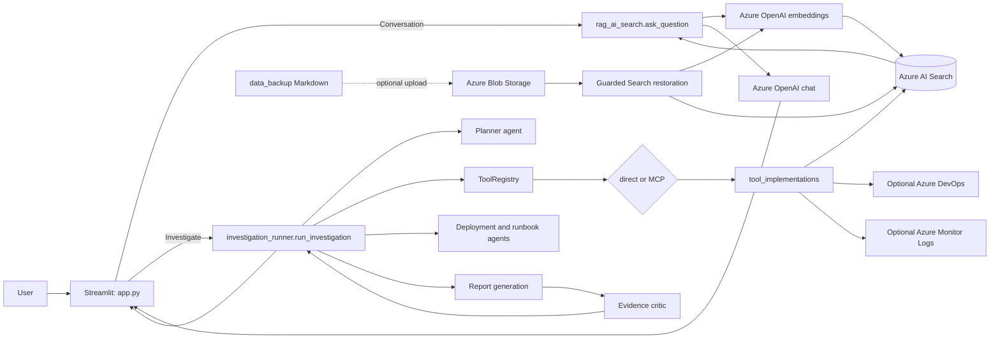
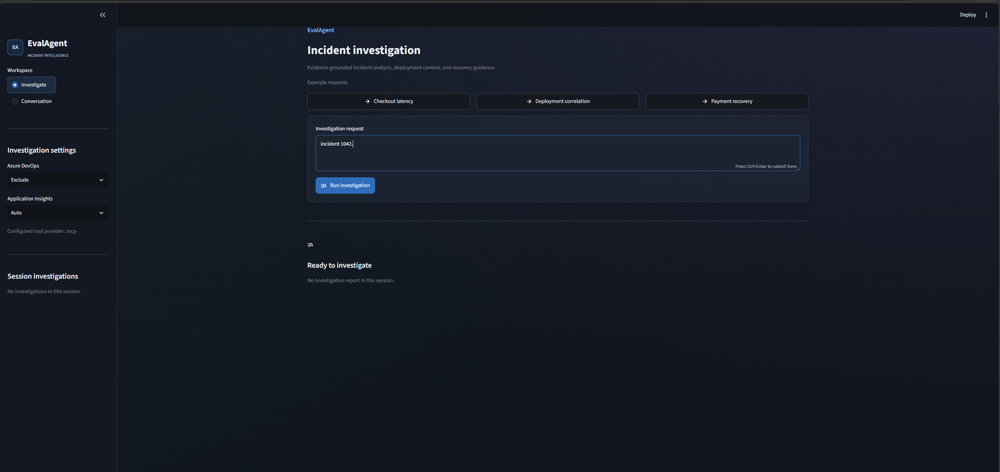
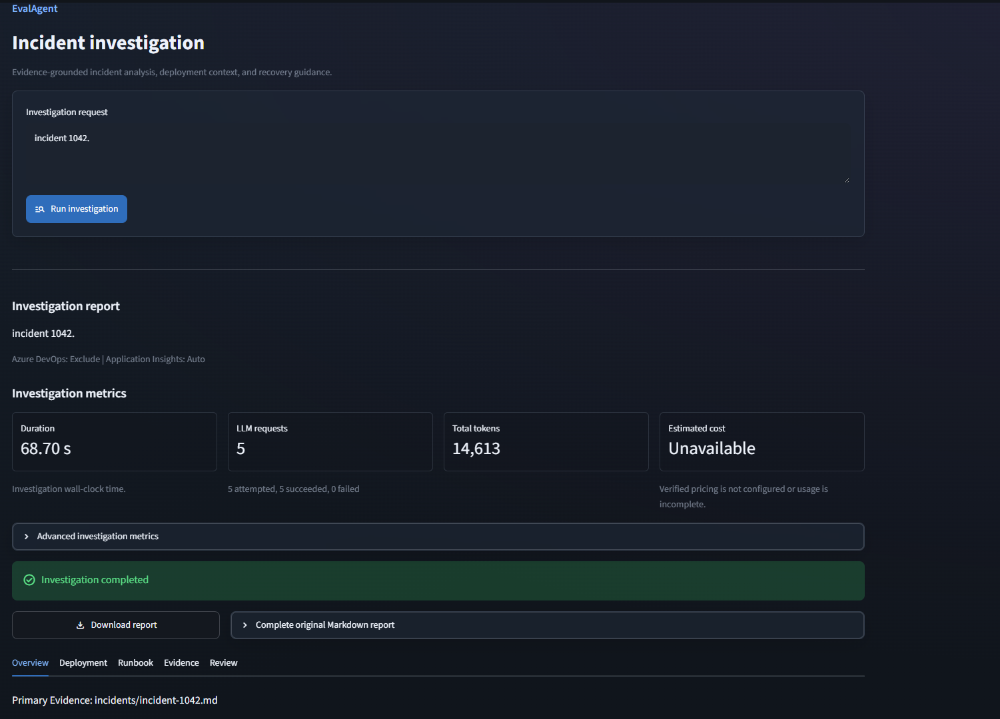
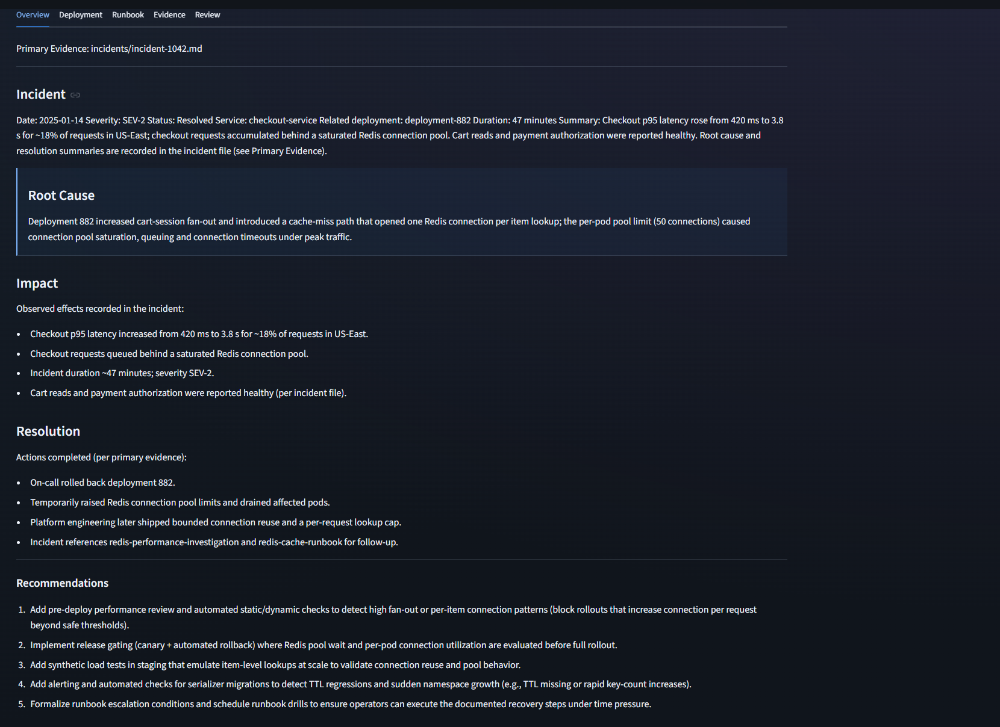
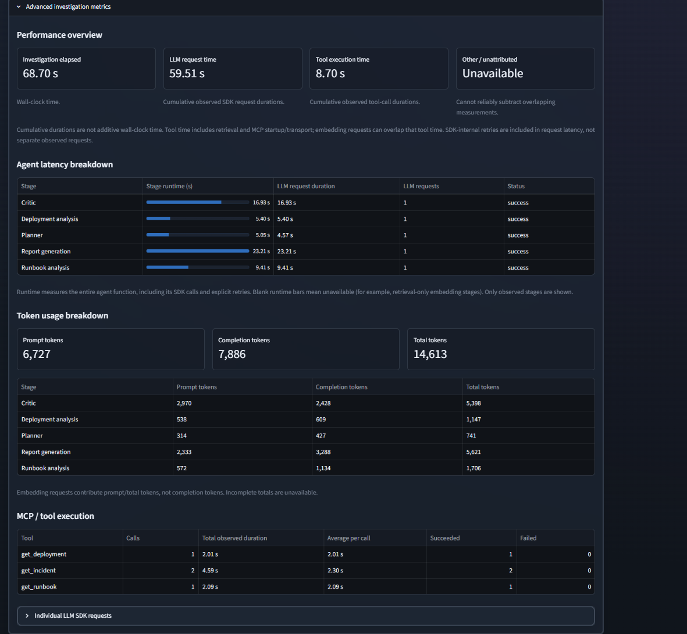

# EvalAgent: Evidence-Grounded Incident Investigation

EvalAgent is an incident investigation assistant for site reliability engineering (SRE) and DevOps workflows. It combines a Streamlit interface, a code-orchestrated multi-agent investigation pipeline, Azure OpenAI, Azure AI Search, and optional Azure DevOps and Application Insights evidence sources.

Rather than answering an incident question from a single free-form prompt, the investigation workflow plans evidence collection, retrieves incident and related operational documents, performs focused deployment and runbook analyses, creates a structured report, and asks a separate critic agent to identify unsupported claims and evidence gaps. Reports and the evidence view include source filenames, chunk identifiers, and evidence references so an engineer can inspect the material behind the generated analysis.

> **Deployment:** EvalAgent is Dockerized and supports local execution with user-provisioned Azure resources. Public cloud hosting is not currently configured.

## What it demonstrates

- **Multi-agent workflow engineering:** planner, evidence retrieval, deployment and runbook analysis, report generation, and evidence critic stages coordinated by application code.
- **Evidence-grounded RAG:** vector retrieval returns source filenames and chunk identifiers; exact document retrieval reconstructs all matching chunks in numeric order.
- **MCP tool integration:** seven stdio tools can run through either a direct provider or a local MCP subprocess provider.
- **Evaluation and regression testing:** a deterministic harness measures expected evidence selection, keyword coverage, and the critic verdict without using a second LLM judge.
- **Operational observability:** allowlisted JSON events and per-investigation request, token, latency, agent, and tool metrics; unavailable telemetry is represented as incomplete rather than as a fabricated zero.
- **Recoverable Search source data:** 30 tracked Markdown files are stored in [`data_backup/`](data_backup/). A guarded command restores Azure AI Search from Markdown in Blob Storage; the [architecture and restoration guide](ARCHITECTURE_GUIDE.md) documents how to seed Blob from the local backup.

### What the workflow is designed to answer

- Which incident document is primary, and what does it actually establish about impact, service behavior, cause, and resolution?
- Which deployment or runbook is linked to the incident, and what supporting evidence does it contribute?
- What operational data is available from optional integrations for the relevant service and time period?
- Which report statements are directly supported, which evidence is missing, and what follow-up investigation would close the gaps?

The application is intended to help an engineer organize investigation evidence, not to take production actions. It does not execute runbook commands, roll back deployments, remediate services, or autonomously select and call tools.

## Engineering highlights

### A code-controlled multi-agent pipeline

The investigation stages have distinct responsibilities and explicit data boundaries:

| Stage | Responsibility | Grounding boundary |
|---|---|---|
| **Investigation planner** | Parses the request into incident/deployment/runbook references, search flags, and optional telemetry context. | Returns a JSON plan; the Python runner controls tool selection and execution. |
| **Evidence retrieval** | Fetches exact incident, deployment, and runbook documents or performs vector search when an incident is not identified. | Returns document paths, chunk IDs, content, and source metadata. |
| **Deployment analyst** | Summarizes retrieved changes, evidence-supported risks, related incidents, and rollback status. | Receives deployment evidence only; risk is not inferred from incident severity. |
| **Runbook analyst** | Extracts purpose, immediate actions, escalation conditions, recovery steps, and any explicitly stated risk. | Receives retrieved runbook text only. |
| **Report writer** | Produces a report with separate incident, root cause, impact, resolution, recommendations, and evidence sections. | Prompted to mark unknown facts as not established and not confuse absent evidence with evidence of absence. |
| **Evidence critic** | Reviews report claims against the selected evidence and lists unsupported claims and evidence gaps. | A model-generated review; it is not an independent or guaranteed fact checker. |

This design makes the orchestration path visible and testable without claiming that the LLM agents are deterministic or that a critic eliminates hallucinations.

### Retrieval and evidence trail

The active Azure AI Search index stores Markdown chunks with a source filename, numeric chunk ID, text, and vector embedding. The ingestion pipeline uses 500-character chunks with 100-character overlap. Conversation retrieves up to five nearest vector results. Exact document lookups use the existing filterable `file` field, preserve exact case-insensitive basename matching, consume paginated results, and sort by numeric chunk ID.

The standard Conversation path is vector retrieval; it is not hybrid text/vector search and currently has no score threshold. Investigation mode can combine exact document retrieval with vector retrieval and retains provenance metadata for evidence selection and display. The source documents are Markdown; embeddings are regenerated during restore rather than stored in Git.

### Optional operational context

- **Azure DevOps:** When enabled, deployment evidence is scanned for recognized work-item, pull-request, and repository identifiers. Matching records can be added as supporting evidence. The UI excludes this integration by default.
- **Application Insights / Azure Monitor Logs:** When selected and the plan/evidence provides a service and usable time bounds, the tool queries workspace-based telemetry for requests, dependencies, traces, and exceptions. It does not guarantee telemetry exists for every investigation.
- **MCP:** A provider switch routes the same seven investigation tools through either direct Python calls or a local stdio MCP server. The MCP client starts a subprocess per tool call; it is not a remote MCP deployment or autonomous agent framework.

## Architecture



### Two distinct user workflows

| Workflow | Behavior |
|---|---|
| **Conversation** | Embeds the question, retrieves up to five vector-search chunks, generates an answer from those chunks, and returns source records. It does not use earlier chat turns as backend context. |
| **Investigate** | The planner returns a JSON plan. The runner retrieves primary and supporting evidence, invokes specialized analyses where evidence is available, optionally enriches from Azure DevOps or Application Insights, generates a report, and asks the critic to review it. The runner—not the model—selects and calls tools. |

The investigation report is shown in Overview, Deployment, Runbook, Evidence, and Review tabs. The Review tab is a model-generated assessment, not an independent verification. Investigation and conversation histories live in Streamlit session state and are not durable.

### Tool surface

The MCP server exposes the same tool implementation used by the direct provider:

| Tool | Purpose |
|---|---|
| `get_incident` | Retrieve an incident document by identifier, or search incident evidence from a natural-language request. |
| `get_deployment` | Retrieve deployment evidence by identifier or filename. |
| `get_runbook` | Retrieve runbook evidence by name. |
| `get_work_item` | Retrieve a referenced Azure DevOps work item. |
| `get_pull_request` | Retrieve a referenced Azure DevOps pull request. |
| `get_release` | Retrieve an Azure DevOps release; exposed for tool use, though the current investigation runner does not automatically request it. |
| `get_application_insights_telemetry` | Query and normalize workspace-based Application Insights telemetry. |

## User experience

The Streamlit app has two separate workspaces:

- **Investigate** accepts an investigation request, integration choices, and maintains a session history of reports. The sidebar examples populate the request field; they do not immediately invoke an investigation. Failed investigations retain the inputs and offer a retry.
- **Conversation** answers a document-grounded question and keeps displayed chat messages in session state. Previous messages are not passed back to the RAG backend as conversation context.

Investigation reports are organized into Overview, Deployment, Runbook, Evidence, and Review tabs. The UI includes a control to download the original Markdown report, preserves unknown report sections, and displays retrieved chunk text with filename and chunk identifiers. If a local copy exists under `data/` or `data_backup/`, it can also show that full source document. The application does not fetch full source files from Blob during rendering.

The dashboard's advanced metrics are collapsed by default. They distinguish investigation wall-clock time from cumulative LLM and tool durations, show per-stage request/token measurements where complete, and mark unavailable or incomplete metrics as unavailable instead of substituting zeros. Tool duration may include MCP startup and retrieval, and LLM work may overlap tool duration; these durations should not be added together.

## Screenshots

### Investigation workspace

The main Investigate workspace shows the incident request form, optional integration settings, configured tool provider, and the empty session state before a run.



### Completed investigation and report

The completed investigation view shows the request, high-level run metrics, successful completion status, report download control, and report navigation tabs.



The Overview tab presents the primary incident evidence, generated root-cause analysis, observed impact, resolution actions, and recommendations.



### Advanced investigation metrics

The expanded metrics panel breaks down elapsed time, observed LLM and tool durations, per-agent latency, token usage by stage, and MCP/tool execution counts and outcomes. Cost is shown as unavailable when verified pricing is not configured.



These screenshots use the repository's incident 1042 demonstration data. Review and sanitize screenshots before publishing if the underlying incident details are not intended for public release.

## Technology

| Area | Current implementation |
|---|---|
| Web UI | Python, Streamlit, custom CSS, native Streamlit theme |
| LLM inference and embeddings | Azure OpenAI Python SDK; chat and embedding deployment names are environment configuration |
| Retrieval | Azure AI Search vector queries and exact document lookup; HNSW vector index |
| Source documents | Markdown in Blob Storage for ingestion, with a tracked repository backup in `data_backup/` |
| Agent tool boundary | Local Model Context Protocol (MCP) stdio client/server, optional via provider setting |
| Optional integrations | Azure DevOps REST API; Azure Monitor Logs query API for Application Insights |
| Application identity | `DefaultAzureCredential` in Blob and Azure Monitor clients; API keys in current OpenAI and Search clients |
| Observability | Allowlisted JSON console events and per-investigation in-memory metrics |
| Tests | Python `unittest` and `unittest.mock`; offline bootstrap blocks external network access |
| Container | Digest-pinned Python 3.13 slim image, binary wheels, non-root runtime user |

## Repository map

```text
evalagent/
├── app.py                         # Streamlit entry point and session workflows
├── frontend.py                    # Report, evidence, and metrics presentation
├── assets/dashboard.css           # Responsive dashboard styling
├── .streamlit/config.toml         # Streamlit theme and safe error-display setting
├── backend/
│   ├── investigation_runner.py    # Investigation orchestration and report assembly
│   ├── investigator_agent.py      # Planner
│   ├── deployment_agent.py        # Deployment analysis
│   ├── runbook_agent.py           # Runbook analysis
│   ├── critic_agent.py            # Evidence-based report review
│   ├── rag_ai_search.py           # Conversation RAG workflow
│   ├── search_ai_search.py        # Vector and exact-document retrieval
│   ├── tool_registry.py           # Direct/MCP provider facade
│   ├── tool_implementations.py    # Shared retrieval and integration calls
│   ├── evalagent_mcp_client.py    # Local MCP subprocess client
│   ├── evalagent_mcp_server.py    # Seven stdio tools
│   ├── observability.py           # JSON events and request/execution metrics
│   ├── ingest_ai_search.py        # Existing Blob-to-Search ingestion pipeline
│   └── restore_search_index.py   # Guarded, create-only restoration command
├── data_backup/                   # Tracked Markdown source backup
├── scripts/upload_data_to_blob.py # Optional local backup upload helper
└── tests/
    ├── eval_cases.json            # Fixed real-evaluation cases
    └── test_*.py                  # Offline mocked regression tests
```

The legacy local FAISS files and modules are not used by the active app. The Docker image explicitly copies the active runtime modules rather than the whole repository.

## Quick start

### Requirements

- Python 3.13 is the version used by the pinned Docker image.
- Azure OpenAI chat and embedding deployments.
- Azure AI Search with the index configured for this application.
- Azure credentials for Blob Storage only when restoring from Blob, and for Application Insights when that integration is enabled.

The repository pins its direct runtime dependencies in [`requirements.txt`](requirements.txt) and constrains transitive packages in [`requirements.lock`](requirements.lock).

### Install and configure

From the repository root, in PowerShell:

```powershell
git clone https://github.com/Tezfai/evalagent.git
Set-Location evalagent
py -3.13 -m venv .venv
.\.venv\Scripts\Activate.ps1
python -m pip install -r requirements.txt
Copy-Item .env.example .env
```

Edit `.env` with the endpoints, keys, index, and deployment names for your own Azure resources. Values in `.env.example` are examples, not resource names that are guaranteed to exist. The app currently authenticates to Azure OpenAI and Azure AI Search with API keys. Blob Storage and Application Insights use `DefaultAzureCredential`; `az login` is one local development option when the identity has the required data-plane permissions.

Use the [configuration reference and setup guide](ARCHITECTURE_GUIDE.md#6-configuration-reference) for variable meanings, optional integrations, and least-privilege guidance.

### Run the application

```powershell
python -m streamlit run app.py
```

Open the local URL printed by Streamlit. Azure-backed requests require valid configuration and may incur Azure charges.

### Restore an empty Azure AI Search index

The recommended guarded command is:

```powershell
python -m backend.restore_search_index
```

It reads Markdown from the configured Blob container, creates embeddings, creates the existing index schema, and uploads chunks. It refuses to replace an existing index. If the Blob container needs the tracked local backup, first create a suitable empty container and upload the Markdown files as documented in [Search restoration](ARCHITECTURE_GUIDE.md#5-restoring-azure-ai-search).

**Cost and safety:** real restoration makes Azure OpenAI embedding calls and consumes Azure AI Search capacity. The original `backend/ingest_ai_search.py` entry point retains delete-and-recreate behavior; do not use that direct entry point for a guarded restore. Restoration requires a Search admin key; before running the long-lived app, replace it in `.env` with a query key. The current code uses the same `AZURE_SEARCH_KEY` setting for both operations.

## Developer commands

```powershell
# Full offline regression suite; uses mocks and blocks external network access.
python -B -m unittest discover tests -v

# List MCP tools using the real local stdio server without invoking Azure tools.
python -m backend.evalagent_mcp_client

# Run the real investigation evaluation harness (uses Azure and may incur charges).
python -m backend.eval_harness
```

The offline suite does not require `.env`, Azure credentials, or paid model calls. The real evaluation harness runs the investigation workflow against the fixed cases in [`tests/eval_cases.json`](tests/eval_cases.json); do not change its cases or scoring threshold merely to improve a result.

## Docker

The Dockerfile builds a Linux/amd64 image from a digest-pinned Python 3.13 slim base, installs pinned dependencies, runs as UID 10001, and exposes Streamlit on port 8501. The build context is allowlisted: it excludes `.env`, tests, `data_backup/`, and the restore/ingestion modules. Restore the index from the repository environment, not from the image.

```powershell
docker build --platform linux/amd64 -t evalagent:local .
docker run --detach --init --name evalagent --cap-drop ALL `
  --security-opt no-new-privileges:true `
  --env-file .env.runtime `
  --publish 127.0.0.1:8501:8501 `
  evalagent:local

(Invoke-WebRequest -UseBasicParsing http://127.0.0.1:8501/_stcore/health).StatusCode
docker stop --time 30 evalagent
docker rm evalagent
```

Create `.env.runtime` with the serving configuration and a Search query key; do not copy the restore-only admin key into it. The health endpoint verifies that Streamlit responds; it does not verify Azure credentials, model deployments, Search data, or optional integrations. Keep local Docker bound to loopback. The image disables dotenv loading, so runtime values must be injected through the container environment.

Stopping the local Docker container or Streamlit process stops only the local application; it does not stop or delete Azure resources or their billing. Review and shut down or delete billable cloud resources separately.

## Important limitations

- No application authentication, Azure Container Apps configuration, infrastructure-as-code, CI/CD deployment pipeline, or durable investigation storage is included.
- Search and OpenAI runtime clients use API-key credentials. Azure managed identity is used by Blob Storage and Application Insights clients, not by the current Search/OpenAI clients.
- Search restoration recreates the index from source Markdown; it does not restore an exact historical index snapshot. The prior audit found content differences between the historical live index and chunks regenerated from the Git backup.
- The evaluation harness is deterministic in how it scores a produced report, but the report itself and its critic assessment are model-generated.
- Cost estimates are not configured. Observability reports token usage and measured durations when available; estimated cost remains unavailable without verified pricing.
- Azure OpenAI Standard deployments are generally usage-billed, while provisioned-throughput deployments can incur capacity charges for reserved throughput. Verify the actual deployment type, region, and billing terms; stopping local Docker or Streamlit does not stop Azure charges.

See [`ARCHITECTURE_GUIDE.md`](ARCHITECTURE_GUIDE.md) for detailed data flows, configuration, source-data recovery, security boundaries, Docker operation, testing, and deployment-readiness checks.
